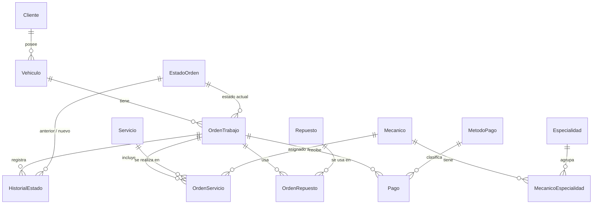

# Documentación técnica

## 1. Arquitectura
Navegador (HTML/CSS/JS) → Django (`core/views.py`) → `core/db.py` → SQL Server (tablas, vistas, funciones, procedimientos).

Las reglas de negocio críticas viven en SQL Server (procedimientos con transacción) para que se cumplan
aunque alguien acceda a la base desde otro sistema. Django valida formatos y muestra los mensajes que
lanzan los procedimientos con `THROW`.

## 2. Diagrama entidad-relación
Se puede pegar en https://mermaid.live o en dbdiagram.io (adaptando la sintaxis) para exportarlo como imagen.



## 3. Modelo relacional (PK subrayada = `PK`, FK marcada)
- **Cliente**(IdCliente PK, Nombre, NIT, Telefono, Correo, Direccion, FechaRegistro)
- **Vehiculo**(IdVehiculo PK, IdCliente FK, Placa UNIQUE, Marca, Modelo, Anio, Color, VIN, Kilometraje)
- **Mecanico**(IdMecanico PK, Nombre, Telefono, TarifaHora, Activo)
- **Especialidad**(IdEspecialidad PK, Nombre)
- **MecanicoEspecialidad**(IdMecanico PK/FK, IdEspecialidad PK/FK)
- **EstadoOrden**(IdEstado PK, Nombre, Secuencia)
- **OrdenTrabajo**(IdOrden PK, IdVehiculo FK, IdEstado FK, FechaIngreso, KmIngreso, FallaReportada, Diagnostico, Observaciones, Descuento, FechaEntrega)
- **HistorialEstado**(IdHistorial PK, IdOrden FK, EstadoAnterior FK, EstadoNuevo FK, FechaCambio, Usuario, Comentario)
- **Servicio**(IdServicio PK, Nombre, Descripcion, PrecioBase, Activo)
- **OrdenServicio**(IdOrdenServicio PK, IdOrden FK, IdServicio FK, IdMecanico FK, Precio, HorasManoObra, TarifaHora)
- **Repuesto**(IdRepuesto PK, Codigo UNIQUE, Nombre, Precio, Stock, StockMinimo)
- **OrdenRepuesto**(IdOrdenRepuesto PK, IdOrden FK, IdRepuesto FK, Cantidad, PrecioUnitario)
- **MetodoPago**(IdMetodoPago PK, Nombre)
- **Pago**(IdPago PK, IdOrden FK, IdMetodoPago FK, Monto, FechaPago, Referencia)

### Normalización
- **1FN:** todos los atributos son atómicos; las especialidades de un mecánico van en una tabla aparte en vez de una lista.
- **2FN:** las tablas con PK compuesta (MecanicoEspecialidad) no tienen atributos que dependan de solo una parte.
- **3FN:** los datos del cliente no se repiten en Vehiculo ni en la orden; el estado es un catálogo.
- **Desnormalización intencional:** `OrdenServicio.Precio`, `OrdenServicio.TarifaHora` y `OrdenRepuesto.PrecioUnitario`
  copian el precio vigente. Si mañana sube el precio de un servicio, las órdenes antiguas deben conservar lo que se cobró.
- El **total no se guarda**: se calcula con `fn_TotalOrden` para que nunca quede desactualizado.

## 4. Reglas de negocio (dónde se validan)
| Regla | Implementación |
|---|---|
| Placa única | `UQ_Vehiculo_Placa` + `sp_RegistrarClienteVehiculo` |
| Un vehículo no puede tener dos órdenes abiertas | `sp_CrearOrden` |
| El kilometraje no puede bajar | `sp_CrearOrden` |
| Los estados avanzan de uno en uno; solo se cancela antes de Terminado | `sp_CambiarEstadoOrden` |
| No se pasa a Reparación sin diagnóstico y sin servicios | `sp_CambiarEstadoOrden` |
| No se entrega con saldo pendiente | `sp_CambiarEstadoOrden` |
| Cada cambio queda en el historial con usuario y fecha | `sp_CrearOrden`, `sp_CambiarEstadoOrden` |
| No hay repuestos sin stock | `sp_AgregarRepuestoOrden` (UPDLOCK + ROLLBACK) |
| Cancelar devuelve los repuestos al inventario | `sp_CambiarEstadoOrden` |
| No se paga más que el saldo; tarjeta/transferencia exige referencia | `sp_RegistrarPago` |
| Montos y cantidades no negativos | restricciones `CHECK` |

## 5. Procedimientos almacenados
| Procedimiento | Uso en la app | Tablas afectadas |
|---|---|---|
| sp_RegistrarClienteVehiculo | Nuevo cliente | Cliente, Vehiculo |
| sp_CrearOrden | Nueva orden | OrdenTrabajo, HistorialEstado, Vehiculo |
| sp_CambiarEstadoOrden | Botones de estado | OrdenTrabajo, HistorialEstado, Repuesto |
| sp_AgregarServicioOrden | Asignar servicio y mecánico | OrdenServicio |
| sp_AgregarRepuestoOrden | Agregar repuesto | OrdenRepuesto, Repuesto |
| sp_RegistrarPago | Registrar pago | Pago |
| sp_ActualizarDiagnostico | Guardar diagnóstico | OrdenTrabajo |
| sp_HistorialVehiculo | Historial por vehículo | (consulta) |
| sp_ReporteIngresos | Reporte 1 | (consulta) |

## 6. Cómo funciona una transacción (para la defensa)
```sql
BEGIN TRY
    BEGIN TRAN;                -- inicia
        -- validaciones con THROW (si fallan, salta al CATCH)
        -- UPDATE / INSERT en varias tablas
    COMMIT;                    -- todo salió bien: se confirma
END TRY
BEGIN CATCH
    IF @@TRANCOUNT > 0 ROLLBACK;   -- algo falló: se deshace TODO
    THROW;                          -- se reenvía el error a Django
END CATCH
```
`WITH (UPDLOCK)` bloquea la fila leída para que dos usuarios no tomen el mismo stock al mismo tiempo.
